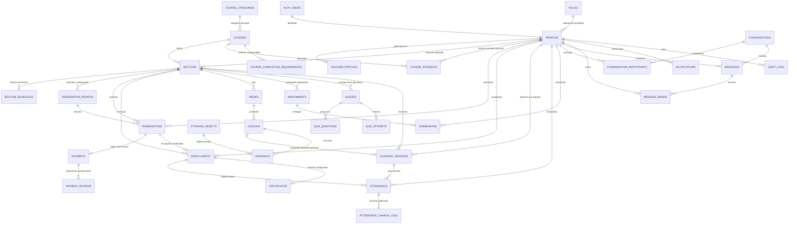

# FASE 2 — Reglas de negocio y modelo de datos

> Diseño conceptual para EDUKATECH. Este documento no es una migración ni una especificación SQL ejecutable. Distingue lo que está confirmado por las instrucciones y el código existente de lo que se propone para el modelo y lo que requiere confirmación. No se modificaron los esquemas ni se ejecutó SQL.

## 1. Objetivo, alcance y arquitectura fijada

La plataforma se implementará posteriormente con Next.js 16 App Router, React 19 y TypeScript; Supabase PostgreSQL será la única base principal de producción y proporcionará Auth, Storage privado y Realtime para el chat; Drizzle se conservará para acceso tipado desde servidor; Vercel será el entorno de despliegue. Esta decisión está fijada y no se reabre en esta fase.

El objetivo de este diseño es establecer un modelo de negocio coherente con las funciones del inventario de frontend, distinguir los ciclos independientes de cuenta, interés, reserva, pago e inscripción, y señalar el desfase entre el esquema Drizzle y `database_schema.sql`.

### Etiquetas usadas

- **[EXISTENTE]**: presente en el inventario, Drizzle o SQL legacy. No implica que funcione con datos reales.
- **[PROPUESTO]**: necesario para cubrir el negocio descrito, sujeto a las decisiones pendientes.
- **[PENDIENTE]**: no hay evidencia suficiente para fijar la regla o cardinalidad.
- **[DECISIÓN CONFIRMADA]**: regla aprobada para la primera versión.

El frontend inventariado es principalmente demo: los paneles aún consumen datos locales y sus formularios académicos, de pago, chat y administración no persisten en un backend productivo. La autenticación real con Supabase SSR y el bloqueo preventivo de paneles se prepararon en FASE 5, pero no se verificaron contra un proyecto Supabase. Por tanto, las pantallas no se toman como prueba de que una regla de negocio ya esté operativa.

### Decisiones confirmadas para la primera versión

- **[DECISIÓN CONFIRMADA]** Modalidades presencial y virtual; no se implementa modalidad híbrida. El estudiante se inscribe en una sección cuya modalidad es la elegida.
- **[DECISIÓN CONFIRMADA]** Interés público sin inicio de sesión con datos mínimos; no se crea una entidad de postulación formal.
- **[DECISIÓN CONFIRMADA]** Curso como oferta académica general y sección/convocatoria como edición concreta, con docente, modalidad, fechas, horarios, disponibilidad, periodo de reserva, estado y sesiones.
- **[DECISIÓN CONFIRMADA]** Reservas asociadas a una sección y con periodos configurados por administración; sin vencimientos automáticos ni mínimos de interesados inventados.
- **[DECISIÓN CONFIRMADA — FASE 6]** Administración puede confirmar o cancelar manualmente una reserva y conservar el cambio en el historial. No se cancelan ni vencen reservas automáticamente.
- **[DECISIÓN CONFIRMADA]** Pago manual, sin pasarela ni pagos parciales. Pago, reserva, cuenta e inscripción son ciclos independientes. Solo un administrador autorizado verifica; tras confirmación, el administrador crea/habilita la cuenta, invita al usuario a establecer contraseña y confirma la inscripción. La decisión debe validarse en servidor y dejar historial.
- **[DECISIÓN CONFIRMADA]** Una organización inicial, sin modelo multiinstitución/multisede; administración global dentro de permisos. Superadmin gestiona plataforma y administradores.
- **[DECISIÓN CONFIRMADA]** Una categoría principal por curso.
- **[DECISIÓN CONFIRMADA]** Zona horaria `America/Lima`; se admiten horarios recurrentes y sesiones puntuales, reprogramadas o canceladas. Las sesiones son referencia de asistencia.
- **[DECISIÓN CONFIRMADA]** Contenidos, tareas y quizzes operativos pertenecen a una sección. Se pueden usar plantillas de curso general si se necesita reutilización, sin mezclar plantillas con actividades operativas.
- **[DECISIÓN CONFIRMADA]** Cambios posteriores a la asistencia requieren autorización, actor y justificación. No es obligatorio el autorregistro QR.
- **[DECISIÓN CONFIRMADA]** Criterios de finalización configurables por curso; la emisión de certificados podrá ser automática o manual según configuración, sin umbrales universales.
- **[DECISIÓN CONFIRMADA]** Chat individual 1:1, únicamente entre estudiante-docente asignado, estudiante-administrador para soporte o docente-administrador. No hay grupos ni acceso global de superadmin por rol.
- **[DECISIÓN CONFIRMADA]** Cuentas se desactivan sin borrar historia académica; no se eliminan automáticamente pagos, matrículas ni auditorías. La política final de retención queda pendiente antes de producción.
- **[DECISIÓN CONFIRMADA]** La tienda, si se confirma como venta real, se modelará separada de matrículas y sus pagos. Su alcance comercial aún no está aprobado.

## 2. Modelo de negocio y límites del dominio

El dominio académico se organiza alrededor de un **curso**, que puede ofrecerse mediante una o más **secciones**. Una sección determina la oferta concreta: modalidad, docente asignado, periodos y sesiones académicas. Una persona puede manifestar interés sin quedar postulada, reservada o inscrita. Las reservas se gestionan en periodos definidos por administración. El pago es una verificación manual separada del estado de la cuenta y de la inscripción. El acceso al contenido depende de una inscripción autorizada y de una cuenta habilitada.

Las entidades conceptuales no corresponden a páginas o componentes. Varias vistas del dashboard consultan los mismos registros de cursos, secciones, personas, pagos, sesiones, asistencia y actividad académica.

### Alcance no asumido

- No se modela una pasarela, pago automático, integración bancaria ni verificación automática de vouchers.
- La capacidad y disponibilidad pueden configurarse por sección; no se fija un valor ni regla universal. No se inventan mínimos de interesados, vencimientos ni cancelaciones automáticas, reembolsos, listas de espera ni prorrateos. La cancelación manual por administración sí está contemplada.
- La tienda de componentes mecatrónicos (`/tienda`) aparece en el frontend, pero no hay evidencia suficiente de que forme parte del flujo educativo de cursos ni de las reglas de esta fase. Su catálogo, pedidos, inventario y ventas quedan fuera del modelo académico hasta confirmar su alcance.
- El inventario y Drizzle incluyen híbrido como demo/modelo anterior; **no forma parte de la primera versión aprobada**. La modalidad individual por sesión tampoco aplica: queda definida por sección.

## 3. Entidades y atributos preliminares

Los nombres son conceptuales; no definen nombres definitivos de tablas, enums o columnas.

### 3.1 Identidad, perfiles y roles

| Entidad | Estado | Atributos preliminares y propósito |
|---|---|---|
| `auth.users` | **[EXISTENTE: servicio Supabase decidido; integración no implementada]** | Identidad, credenciales, email y verificación administrados por Supabase Auth. La aplicación no debe duplicar contraseñas ni tratar el email del perfil como identidad de autenticación. |
| `profiles` / perfil de aplicación | **[PROPUESTO]** | PK/FK `user_id` = `auth.users.id`; nombre, apellido, foto (referencia privada/pública según política), teléfono, país, idioma, código de estudiante opcional, `account_status`, timestamps. El rol no se obtiene de un campo que el usuario pueda actualizar. |
| `roles` | **[EXISTENTE]** | Catálogo controlado de `superadmin`, `admin`, `profesor`, `alumno`. Se puede mantener como catálogo, pero no ofrecer autoasignación ni edición libre de privilegios. |
| `profiles.role_id` o asignación de rol | **[PROPUESTO]** | Relación entre perfil y rol concedido exclusivamente por operación autorizada. Se propone conservar un rol principal por usuario, coherente con el esquema actual; el usuario nunca puede asignárselo ni elevarlo. |
| `teacher_profiles` | **[EXISTENTE]** | Relación 1:1 con perfil; biografía, especialidades, certificaciones, enlace profesional y experiencia. Los datos públicos deben limitarse a campos expresamente publicados. |

El UUID de `auth.users` será la identidad canónica en las tablas de aplicación. El perfil complementa esa identidad; no crea una segunda cuenta con otro UUID independiente. La creación del usuario o invitación y el alta del perfil deben hacerse en flujo de servidor autorizado. El usuario puede editar únicamente los campos personales permitidos, nunca su rol, estado de habilitación o asignaciones.

### 3.2 Catálogo y oferta académica

| Entidad | Estado | Atributos preliminares y propósito |
|---|---|---|
| `course_categories` | **[PROPUESTO]** | Categorías con nombre, slug y estado de publicación. Cada curso tendrá una categoría principal mediante FK única; no crear relación muchos-a-muchos ni una entidad por filtro visual. |
| `courses` | **[EXISTENTE]** | Plantilla académica: `id`, slug único, título, descripción corta/larga, portada, nivel, duración, precio base/moneda si corresponde, publicación y certificado habilitado. Debe ser administrada, no escrita libremente por usuarios. |
| Relación curso-categoría | **[DECISIÓN CONFIRMADA]** | Cada curso tiene una categoría principal; relación N:1 desde curso, sin tabla puente. |
| `sections` (ofertas/cohortes) | **[EXISTENTE en Drizzle; ausente del SQL legacy]** | Edición concreta: `id`, `course_id`, código, modalidad presencial/virtual, docente, fechas de inicio/fin, capacidad/disponibilidad configuradas, estado, ubicación/datos de conexión y periodo de reserva. No asumir valores universales ni vencimientos automáticos. |
| `section_schedules` | **[PROPUESTO]** | Horarios recurrentes por sección: día, hora local, zona `America/Lima` y vigencia. Se consulta sin analizar texto arbitrario. |
| `reservation_periods` | **[PROPUESTO]** | Periodos explícitos de reserva ligados a una sección, configurados por administrador autorizado, con apertura/cierre, creador y fechas. No se añaden vencimientos automáticos. |

**Modalidad [DECISIÓN CONFIRMADA]:** valores controlados `virtual` y `presencial` para la primera versión. La modalidad corresponde a la sección y determina la oferta a la que se inscribe el estudiante. No implementar `híbrida` ni selector de modalidad individual por sesión.

### 3.3 Interés, postulación, reserva, pago e inscripción

Son conceptos distintos y no deben compartir un único `estado`.

| Entidad | Estado | Atributos preliminares y propósito |
|---|---|---|
| `course_interests` (interesados) | **[PROPUESTO]** | `id`, `course_id`, usuario opcional, nombre, correo, teléfono/WhatsApp, modalidad deseada (presencial/virtual), horario preferido opcional y `created_at`. Una persona puede enviarlo sin autenticarse. Representa demanda, no postulación, reserva ni matrícula. |
| Postulación formal independiente | **[DECISIÓN CONFIRMADA: no crear]** | No se modela una entidad de postulaciones: el proceso identificado empieza con interés y continúa con gestión de reserva. Se reevalúa solo si aparece un proceso institucional adicional. |
| `reservations` | **[PROPUESTO]** | `id`, persona, `section_id`, `reservation_period_id`, timestamps, administrador gestor y estado (`pending`, `confirmed`, más solo si se aprueban reglas). La confirmación no es inscripción ni pago. |
| `payments` | **[EXISTENTE, pero divergente entre archivos]** | Pago manual relacionado con una reserva concreta, monto/moneda y método declarado, referencia opcional, comprobante privado, estado (`pending`, `verified`, `rejected`), revisor, fecha y motivo. Sin pasarela ni pagos parciales. |
| Historial de verificación | **[PROPUESTO]** | Registrar cada decisión/revisión con actor autorizado, estado anterior/nuevo, fecha y justificación; no sobrescribir la trazabilidad con una sola actualización de `aprobado_por`. |
| `enrollments` | **[EXISTENTE]** | Relaciona estudiante con sección y representa inscripción confirmada por un administrador autorizado tras verificar el pago y completar la habilitación/invitación. Su creación se separa de la reserva y del pago. |
| Relación pago-reserva-inscripción | **[DECISIÓN CONFIRMADA]** | Flujo normal: interés → reserva a sección → pago total manual → verificación por administrador → cuenta creada/habilitada e invitación para establecer contraseña → inscripción confirmada y acceso. Cada ciclo conserva su propio estado; validación en servidor. La multiplicidad de registros de revisión preserva historial; no se admiten pagos parciales. |

El usuario puede expresar interés sin iniciar sesión **[DECISIÓN CONFIRMADA]**. El formulario solicita únicamente nombre, correo, teléfono/WhatsApp, curso, modalidad deseada y horario preferido cuando corresponda. Se limita la lectura a personal autorizado y no se crea una cuenta de autenticación ni una reserva por registrar interés.

### 3.4 Contenido, sesiones académicas y asistencia

| Entidad | Estado | Atributos preliminares y propósito |
|---|---|---|
| `weeks` | **[EXISTENTE en Drizzle]** | Unidad de contenido vinculada a sección, número, título y descripción. `UNIQUE(section_id, number)`. |
| `lessons` (actual `clases`) | **[EXISTENTE]** | Contenido operativo de una sección: semana, orden, título, descripción, duración y publicación. No representa por sí solo cada ocurrencia impartida. |
| `academic_sessions` | **[PROPUESTO]** | Sesión puntual asociada a sección y opcionalmente a una lección, con fecha/hora concreta en `America/Lima`, docente y estado programada/reprogramada/cancelada. Reprogramaciones y cancelaciones conservan trazabilidad; la sesión es la unidad de asistencia. |
| `section_schedules` | **[PROPUESTO]** | Configuración recurrente del horario. No sustituye a `academic_sessions`; las sesiones concretas pueden originarse en ese horario y modificarse/cancelarse de forma trazable. |
| `attendance` | **[EXISTENTE en Drizzle; ausente del SQL legacy]** | Una fila por estudiante y sesión, con estado, registrador y timestamps. La modalidad se deriva de la sección. El docente de la sección registra y consulta; el estudiante consulta solo su historial. |
| Historial de cambios de asistencia | **[PROPUESTO]** | Cambios posteriores restringidos a docentes responsables y administradores autorizados; registrar actor, fecha, valor previo/nuevo y justificación. |
| `attendance_modality_preferences` | **[EXISTENTE en Drizzle; retirar conceptualmente]** | El selector por alumno/clase corresponde al modelo híbrido demo y no aplica: modalidad queda fijada por sección. |
| `attendance_configuration` | **[EXISTENTE en Drizzle; revisar campos]** | Mantener solo configuración académica aprobada. Autorregistro QR no será obligatorio ni parte del flujo inicial; ventanas/cierres no definidos permanecen fuera del modelo de reglas. |

La asistencia se vincula con la **sesión académica**, el estudiante y el contexto de sección/curso/docente. No basta con guardar `student_id` y un `class_id` que representa contenido: hay que garantizar que el estudiante tenga inscripción autorizada a la sección y que el registrador sea el docente asignado o un administrador autorizado. Cada cambio posterior debe conservar quién lo hizo y su justificación.

### 3.5 Tareas, entregas, quizzes y certificados

| Entidad | Estado | Atributos preliminares y propósito |
|---|---|---|
| `assignments` (actual `tareas`) | **[EXISTENTE]** | Título, descripción, fechas indicadas por el docente, rúbrica y reglas de reenvío. Cada actividad operativa pertenece a una sección concreta y contenido de esa sección. El esquema actual mezcla `course_id` con `week_id` de sección. |
| `submissions` (actual `entregas`) | **[EXISTENTE]** | Tarea, estudiante, número de intento, comentario, calificación, feedback y fecha. Archivo mediante referencia a Storage, no URL arbitraria. |
| `quizzes`, `quiz_questions`, `quiz_attempts` | **[EXISTENTE]** | Evaluación, preguntas/opciones, intentos, respuestas y calificación. Cada quiz operativo pertenece a una sección concreta. Restringir acceso a preguntas/respuestas correctas según estado y permisos; impedir intentos sin inscripción. |
| Plantillas académicas | **[PROPUESTO, opcional]** | Materiales o actividades reutilizables vinculados al curso general, separados de sus copias/instancias operativas en cada sección. Crear solo si se confirma necesidad de reutilización. |
| `lesson_progress` | **[PROPUESTO, criterio pendiente]** | Progreso por inscripción/lección si la plataforma necesita medir avance real. Un porcentaje de inscripción no es verificable si no se guardan las unidades completadas o no se define su cálculo. |
| `course_completion_requirements` / configuración | **[PROPUESTO]** | Criterios configurables por curso que pueden incluir asistencia, actividades, evaluaciones u otros requisitos académicos; sin umbrales universales. Definir si se heredan a secciones o se versionan por convocatoria. |
| `certificates` | **[PROPUESTO]** | Emisión asociada a inscripción, código único, fecha, emisor y estado. La configuración del curso determina emisión automática o aprobación manual. El endpoint público de verificación devuelve solo datos mínimos autorizados. |

**[PENDIENTE]** Definir el criterio que habilita completar un curso y emitir certificado. No se presupone que una tasa de asistencia, nota o porcentaje particular sea requisito.

### 3.6 Archivos privados

| Entidad | Estado | Atributos preliminares y propósito |
|---|---|---|
| `storage_objects` / metadatos de archivo | **[PROPUESTO]** | Referencia al bucket privado y ruta/clave del objeto, propietario/subidor, nombre original seguro, MIME/tamaño, fecha y metadatos mínimos. PostgreSQL guarda metadatos y relaciones, no bytes grandes ni URL pública permanente. |
| Materiales de curso | **[EXISTENTE: `materiales`]** | Metadata y vínculo a lección/sección más `storage_object_id`. Requiere inscripción activa/autorizada y política privada en Storage para descargar. |
| Comprobantes de pago | **[EXISTENTE: `voucher_url` legado]** | Vincular el objeto privado al pago. Solo estudiante propietario y personal que revisa pagos puede leerlo. |
| Archivos de entrega | **[EXISTENTE: `archivo_url` legado]** | Asociar el archivo a una entrega; lectura por el estudiante propietario y docente responsable/revisor autorizado. |
| Adjuntos de chat y documentos administrativos | **[PROPUESTO según necesidad]** | Relaciones tipadas con mensaje o registro administrativo. No usar una relación polimórfica sin FK que deje el acceso imposible de validar. |

Todas las áreas privadas de Storage deben autorizar la operación mediante identidad y relación de negocio (propietario, inscripción, asignación o pago). Un nombre de ruta aleatorio o un botón oculto no constituye autorización.

### 3.7 Chat, notificaciones, foros y auditoría

| Entidad | Estado | Atributos preliminares y propósito |
|---|---|---|
| `conversations` | **[EXISTENTE]** | Identificador, tipo con semántica definida y fechas. No conceder acceso por conocer el UUID ni por ser administrador/docente. |
| `conversation_participants` | **[EXISTENTE]** | PK compuesta conversación/usuario, fecha de incorporación y, si se requiere, fecha de salida. Solo un proceso autorizado agrega participantes. |
| `messages` | **[EXISTENTE]** | Conversación, remitente, contenido, fecha y referencias de adjuntos. El remitente debe ser participante; texto o archivo deben validarse para que el mensaje no quede vacío. |
| `message_reads` | **[PROPUESTO]** | Lectura por mensaje y participante, con fecha. Reemplaza el booleano global `mensajes.leido`, que no modela la lectura independiente por cada participante. |
| `notifications` | **[EXISTENTE]** | Destinatario, tipo, título, mensaje, destino interno, lectura/fecha. Cada usuario consulta y actualiza solo sus notificaciones; no incluir contenido sensible de conversaciones privadas. |
| `forum_topics`, `forum_replies` | **[EXISTENTE en Drizzle y SQL; módulo secundario]** | Foro de curso/sección con autores autorizados por inscripción o asignación. Votos deben ser registros por usuario si se necesita evitar duplicados, no un contador libremente modificable. |
| `audit_logs` | **[PROPUESTO]** | Actor autenticado, acción, entidad/referencia, fecha, resultado y metadatos no secretos. Solo escritura controlada de servidor; no edición/borrado por usuarios. Auditar especialmente roles, habilitación, pagos, reservas e inscripciones. |

#### Privacidad y Realtime

- Solo participantes activos pueden consultar conversación, participantes, mensajes y lecturas.
- La lectura/escritura de cambios y la autorización del canal Realtime deben aplicar la misma comprobación de membresía; ocultar una ruta o filtrar el cliente no protege el canal.
- Crear una conversación requiere verificar que el par de participantes corresponde a uno de los vínculos permitidos (estudiante-docente asignado, estudiante-administrador para soporte o docente-administrador). No permitir grupos ni agregar cuentas arbitrarias.
- El administrador no obtiene acceso implícito a chats privados por su rol. El docente tampoco puede acceder a conversaciones en las que no participa.
- Una inscripción al curso no concede acceso a chats de otros alumnos; la pertenencia es siempre a una conversación individual concreta.
- La eliminación/retención de mensajes y archivos de chat está pendiente de política; no inferir borrado en cascada como decisión de producto.

## 4. Estados: límites entre procesos

| Concepto | Entidad que lo representa | Estados/representación respaldados | No debe significar |
|---|---|---|---|
| Interesado | `course_interests` | Registro de interés; puede ser solo un registro creado. No requiere estado de matrícula. | Postulante, reserva o usuario habilitado. |
| Postulante | No existe entidad independiente en la primera versión | No hay un proceso formal adicional; la entidad no se crea. | Sinónimo de interesado, reserva o inscrito. |
| Reserva pendiente/confirmada | `reservations` | `pending`, `confirmed`, según reglas solicitadas. | Pago verificado o acceso académico. |
| Inscrito | `enrollments` | Existencia de una inscripción autorizada a sección. No se fuerza un estado de pago dentro de ella. | Reserva, voucher enviado o cuenta activa por sí sola. |
| Pago pendiente/verificado/rechazado | `payments` y su historial de verificaciones | Verificación manual por administrador autorizado; cada revisión conserva actor, fecha y decisión. Pago total, sin pagos parciales. | Estado de cuenta, reserva o inscripción. |
| Cuenta pendiente de habilitación/activa/suspendida | `profiles.account_status` (o equivalente) | Estado de acceso a la aplicación. Separado de Auth y del ciclo de pago. | Pago pendiente, reserva o progreso académico. |

No usar una columna única como `usuarios.estado` para codificar pago, curso, cuenta e inscripción. Tampoco derivar un estado de otro sin una regla de transición aprobada.

## 5. Procesos de negocio

### 5.1 Interés y demanda

1. La persona, sin requerir sesión, envía interés por curso con nombre, correo, teléfono/WhatsApp, modalidad deseada (presencial o virtual) y horario preferido cuando corresponda.
2. Se persiste la solicitud con fecha y, si existe, vínculo opcional a cuenta; no se recopilan campos innecesarios.
3. La persona no queda inscrita ni reservada por este acto.
4. El administrador consulta la demanda para decidir cuándo abrir una convocatoria. Los docentes solo verán agregados de las secciones/cursos que les correspondan conforme a permisos aprobados.
5. Si no hay sección abierta, la demanda puede agruparse por curso, modalidad y horario preferido.

No se automatiza la creación de secciones por volumen de interesados ni se fija un mínimo para abrir curso; la decisión la toma administración.

### 5.2 Periodo y reserva

1. Un administrador autorizado configura un periodo disponible con fechas explícitas ligado a una sección/convocatoria concreta.
2. El administrador gestiona solicitudes de reserva durante el flujo autorizado.
3. `pending` significa que la solicitud aún no está confirmada; `confirmed` significa que administración confirmó la reserva; `cancelled` significa que una persona autorizada la canceló manualmente.
4. La reserva se mantiene separada de inscripción, cuenta y pago. No expira ni se cancela automáticamente; capacidad/disponibilidad y las fechas se establecen/configuran institucionalmente.
5. Al confirmar una reserva, la comprobación de capacidad y el cambio de estado deberán realizarse atómicamente en PostgreSQL. La lectura previa de disponibilidad es informativa y no evita que dos solicitudes concurrentes ocupen la última plaza.

### 5.3 Verificación manual del pago y habilitación de cuenta

1. El interesado realiza su solicitud; administración gestiona su reserva a una sección.
2. La persona realiza el pago completo fuera de una pasarela; el comprobante se almacena como archivo privado ligado al pago y la reserva.
3. El pago comienza pendiente de revisión. Un administrador autorizado verifica o rechaza manualmente, con actor, fecha y justificación registrados en el historial.
4. Solo después de confirmarse el pago, el administrador crea o habilita la cuenta y envía una invitación para que el usuario establezca contraseña.
5. El administrador confirma la inscripción a la sección y habilita el acceso académico.
6. Pago, reserva, cuenta e inscripción permanecen como procesos y estados distintos; ninguna decisión del frontend puede otorgar acceso o privilegios sin validación de servidor.

No hay pasarela, confirmación bancaria automática ni pagos parciales. Verificar el pago por sí solo no cambia los estados de cuenta/reserva/inscripción.

### 5.4 Inscripción y acceso académico

1. Tras la habilitación/invitación de cuenta, un administrador confirma la inscripción del alumno a la sección asociada con el proceso autorizado.
2. El alumno accede a calendario, lecciones, videos, materiales, entregas, quizzes, notas, asistencia y certificados solo en secciones en las que está inscrito y mientras la cuenta tenga acceso.
3. Un docente accede al contenido y actividad de las secciones que tiene asignadas.
4. La inscripción no se infiere de un interés, reserva confirmada, pago enviado ni cuenta activa.

### 5.5 Sesiones y asistencia

1. Cada sección tiene horario definido y puede generar/administrar sesiones académicas reales.
2. Cada sesión se relaciona con sección y docente que la imparte; opcionalmente se enlaza con una lección del plan de contenido.
3. Un docente autorizado registra asistencia de alumnos inscritos en esa sección; el administrador consulta/gestiona según su alcance.
4. El alumno ve únicamente su propio historial de asistencia; no selecciona modalidad por sesión porque esta queda definida por la sección.
5. La asistencia es única por alumno/sesión. Toda modificación posterior requiere autorización, actor y justificación; se conserva el historial de cambios. El registro manual docente es el flujo inicial; QR no es obligatorio.

### 5.6 Materiales y archivos

1. El usuario solicita acceso mediante una operación autenticada.
2. La autorización se comprueba por contexto (inscripción, propiedad, docencia, administración funcional), no por una URL pública compartida.
3. El servidor o política de Storage entrega acceso temporal controlado cuando corresponda.
4. PostgreSQL conserva metadatos/referencias; Supabase Storage privado conserva el archivo.

### 5.7 Chat y notificaciones

Una conversación individual se crea solo entre una pareja autorizada: estudiante y docente asignado; estudiante y administrador para soporte; o docente y administrador. No hay grupos en la primera versión. Cada mensaje valida remitente como participante y `message_reads` registra lecturas individualmente. Estudiantes no consultan conversaciones ajenas; docentes y administradores solo ven sus propias conversaciones como participantes. El rol de superadministrador no otorga acceso al contenido. Notificaciones son registros por destinatario y no reemplazan permisos del recurso enlazado.

## 6. Roles y responsabilidades

| Rol | Responsabilidad propuesta | Límites principales |
|---|---|---|
| Superadministrador | Control global de la plataforma, incluida la gestión de administradores; supervisión de configuración y auditoría. | No se convierte en lector automático de conversaciones privadas ni en actor que omite auditoría. Asignación privilegiada controlada por un proceso de confianza. |
| Administrador | Gestión global operativa de EDUKATECH dentro de los permisos: cursos/secciones, periodos y reservas, pagos manuales, alta/habilitación de estudiantes, inscripciones y reportes. | No puede otorgarse rol superadmin ni cambiar su propio rol para elevar privilegios. Accede a conversaciones solo si es participante. |
| Docente | Gestiona el contenido/evaluaciones de secciones asignadas; consulta estudiantes inscritos, entrega/calificaciones, asistencia y demanda asociada a sus ofertas. | Sin acceso a cursos ajenos ni funciones de pagos, roles o usuarios globales. Chat solo como participante. |
| Estudiante | Consulta y modifica su perfil permitido, sus intereses/reservas, y consume actividad académica de secciones en las que está inscrito; envía entregas y participa en chats autorizados. | No puede cambiar rol/estado, inscribir a terceros, aprobar pagos ni consultar datos de otros estudiantes salvo información explícitamente compartida en el curso. |

**[DECISIÓN CONFIRMADA] Ámbito:** inicialmente una organización única. El administrador tiene capacidad de gestión global dentro de sus permisos; el superadministrador controla la plataforma y administra los administradores. No se implementa arquitectura multiinstitución o multisede.

## 7. Matriz conceptual de permisos RLS

La autorización debe residir también en PostgreSQL/RLS y Storage, no únicamente en layouts, rutas o componentes. Los siguientes permisos son una propuesta inicial; las operaciones de alta de Auth/roles y las transiciones financieras sensibles requieren funciones de servidor controladas.

| Recurso | Público/visitante | Estudiante | Docente | Administrador | Superadministrador |
|---|---|---|---|---|---|
| Cursos publicados | Leer campos públicos | Leer | Leer públicos y sus asignaciones | CRUD operativo | CRUD global/controlado |
| Perfiles | Leer solo perfil docente publicado | Leer/editar sus campos no privilegiados | Leer/editar sus campos no privilegiados | Gestión operativa de cuentas según ámbito | Gestionar administradores y configuración global; auditoría |
| Rol y estado de cuenta | Ninguno | Leer rol propio; no cambiar rol/estado | Igual | Asignación solo a roles no privilegiados según autorización | Operación privilegiada controlada; no autoescalado |
| Intereses | Crear interés anónimo con campos mínimos; sin listar | Crear/ver los propios | Solo demanda agregada de sus ofertas, sin PII innecesaria | Consulta/gestión global dentro de permisos | Supervisión global según necesidad |
| Reservas/periodos | Sin lectura ni modificación | Solicitar/ver lo propio según flujo | Lectura agregada de demanda, sin operar reservas | Configurar periodos por sección y gestionar reservas globalmente | Supervisión global |
| Pagos/comprobantes | Ninguno | Crear reporte/comprobante de pago y leer lo propio | Ninguno por defecto | Verificar/rechazar manualmente, consultar historial y leer comprobante para esa revisión | Supervisión auditada, sin eludir controles |
| Inscripciones | Ninguno | Leer las propias | Leer de secciones asignadas | CRUD autorizado dentro del ámbito | Supervisión global |
| Contenido/materiales | Solo cursos públicos no privados | Leer sección propia inscrita; no cambiar material | CRUD operativo de secciones asignadas | Gestión global operativa | Gestión global controlada |
| Entregas/notas/quizzes | Ninguno | Crear/ver lo propio | CRUD de evaluaciones y calificar solo secciones asignadas | Lectura/soporte solo según permiso explícito | Supervisión auditada, no exposición indiscriminada |
| Sesiones/asistencia | Ninguno | Leer la propia | Registrar/consultar asistencia en secciones asignadas; corregir con motivo e historial | Consultar/gestionar dentro de permisos; cambios auditados | Supervisión auditada; no altera historial sin autorización |
| Conversaciones/mensajes/lecturas | Ninguno | Solo participante en chat 1:1 autorizado | Solo participante en chat 1:1 autorizado | Solo participante en chat 1:1 autorizado | Solo participante; superadmin no tiene acceso global por rol |
| Notificaciones | Ninguno | CRUD de lectura solo sobre las propias | Igual | Solo destinatario propio o generación controlada | Igual; no leer bandejas ajenas sin finalidad explícita |
| Archivos privados | Ninguno | Propios y contenido de secciones autorizadas | Archivos de secciones asignadas y entregas de sus alumnos | Comprobantes/documentos dentro de tareas administrativas autorizadas | No acceso general a archivos personales/chats |
| Auditoría | Ninguno | Ninguno | Ninguno | Consultar registros de operaciones permitidas; no modificarlos | Lectura global; escritura solo por servidor |

### Principios para las políticas

- `auth.uid()` debe coincidir con `profiles.user_id` para filas propias.
- El rol se consulta desde una fuente protegida; no confiar en metadata editable por el usuario, `sessionStorage`, parámetros del cliente o claims sin validación.
- Revalidar relaciones mediante tablas: estudiante inscrito en la sección; docente asignado a la sección; reserva/pago perteneciente al usuario; participante activo de conversación.
- Las políticas de escritura comprueban `WITH CHECK` además de limitar filas leídas/modificadas.
- Las operaciones privilegiadas se realizan en servidor con autorización explícita, validación de ámbito y privilegio mínimo. Una conexión privilegiada que omite RLS no debe usarse como sustituto de comprobar el actor.
- Denegar por defecto; no habilitar acceso anónimo a tablas privadas. Configurar Realtime con la misma membresía.
- Para Storage, validar bucket/objeto y la fila de negocio vinculada, no solo el prefijo indicado por el cliente.
- Evitar que el administrador cree superadmins desde el flujo normal; evitar que los usuarios actualicen `role_id`, `account_status`, revisiones de pago o identidad del dueño de la fila.

## 8. Relaciones, integridad, restricciones e índices

### Relaciones principales

- `auth.users` 1:1 `profiles`; `roles` 1:N `profiles` si se mantiene un solo rol por cuenta.
- `profiles` 1:0..1 `teacher_profiles`.
- `course_categories` 1:N `courses`; cada curso referencia una categoría principal.
- `courses` 1:N `sections`; docente 1:N `sections`.
- `sections` 1:N `section_schedules`, `reservation_periods`, `weeks`, `academic_sessions` y `enrollments`.
- `course_interests` N:1 `courses`, con sección opcional y usuario opcional.
- `reservation_periods` 1:N `reservations`; `sections` 1:N `reservations`; estudiante 1:N reservas a lo largo del tiempo.
- `reservations` se asocia a una convocatoria/sección y a su periodo de reserva. Pago total manual asociado a la reserva; no se admiten pagos parciales.
- Estudiante N:M `sections` mediante `enrollments`.
- `weeks` 1:N `lessons`; `lessons` 0..1:N `academic_sessions` según el patrón de programación que se confirme.
- `academic_sessions` 1:N `attendance`; cada asistencia se relaciona con estudiante y sesión.
- `sections/weeks/lessons` 1:N tareas y quizzes operativos de la sección. Las plantillas opcionales vinculadas al curso general deben quedar separadas de las instancias activas.
- `assignments` 1:N `submissions`; `quizzes` 1:N preguntas e intentos.
- Conversaciones N:M usuarios mediante participantes; conversación 1:N mensajes; mensajes/participantes 1:N lecturas.
- `storage_objects` se relaciona mediante FK con su uso (material, pago, entrega, mensaje o documento).

### Restricciones e índices recomendados (conceptuales)

- PK UUID para entidades principales; FK a `auth.users.id` para identidades.
- `UNIQUE` por slug de curso; código de sección único en un ámbito definido; `UNIQUE(section_id, week_number)`; `UNIQUE(week_id, lesson_number)`.
- `UNIQUE(student_id, section_id)` en inscripción si no se permite repetir matrícula en la misma sección. Si se permite volver a inscribirse, incluir ciclo/versión que aún debe definirse.
- `UNIQUE(student_id, session_id)` en asistencia; `UNIQUE(conversation_id, user_id)` en participante; `UNIQUE(message_id, user_id)` en lectura.
- `UNIQUE(quiz_id, question_order)` y `UNIQUE(quiz_id, student_id, attempt_number)`.
- `UNIQUE(certificate_code)`; `UNIQUE(bucket, object_key)` para evitar referencias duplicadas al mismo objeto lógico.
- `CHECK(start_at < end_at)` para rangos de horario/sesión; cantidades monetarias no negativas; porcentajes dentro de rango si se almacenan; valores controlados para modalidad (`virtual`, `presencial`) y estado. Capacidad y disponibilidad son configurables por sección, sin imponer valor común.
- Guardar instantes de sesiones de forma inequívoca y presentar/interpretar horarios de negocio en `America/Lima`; diferenciar zona local de almacenamiento UTC cuando corresponda.
- Verificación de pagos, inscripción y habilitación requieren operación autorizada de servidor; preservar historial de cada revisión, no depender de una mutación directa del cliente.
- Restricciones de coherencia cruzada (docente/alumno con rol correcto, inscripción requerida, sección y curso coincidentes) requieren constraints compuestas, procedimientos seguros o triggers cuidadosamente diseñados; no confiar solo en validación de formulario.
- Índices FK de uso frecuente, estados y fechas para revisiones de pagos, reservas, periodos, asistencia y notificaciones; índices por participante/conversación y `(conversation_id, created_at)` para el historial del chat.
- Índices de demanda en curso/modalidad/fecha y sección/horario, ajustados al diseño final de preferencias y reportes.
- Índices de parcialidad/orden para listar inscripciones por sección, pagos pendientes y notificaciones no leídas; comprobar con consultas reales antes de fijar un índice definitivo.

### Reglas de eliminación

- Preferir baja lógica/estado de cuenta para preservar trazabilidad académica y financiera; no borrar en cascada personas, pagos, inscripciones, notas, asistencia o auditoría.
- `CASCADE` se reserva a elementos estrictamente dependientes, por ejemplo preguntas de un quiz eliminado o pertenencia de un participante si existe una política de retención aprobada.
- Para cursos/secciones con actividad histórica, archivar/despublicar en vez de eliminar. Las referencias académicas y pagos deben conservar integridad.
- Retención, anonimización y eliminación de datos personales requieren política legal/operativa **[PENDIENTE]**.

## 9. Estadísticas e indicadores

Las métricas deben calcularse a partir de tablas fuente y aplicar el mismo ámbito que RLS. No persistir contadores editables como fuente de verdad.

| Rol | Métrica | Fuente y cálculo conceptual |
|---|---|---|
| Superadministrador | Cuentas por rol/estado | `profiles`/roles; conteo por `role` y `account_status`. |
| Superadministrador | Cursos y secciones publicados/activos | `courses` y `sections`, agrupados por estado y modalidad. |
| Superadministrador | Interés y demanda | `course_interests`, agrupado por curso, modalidad y horario preferido. Distinguir interés de reservas y decisiones de apertura de convocatoria. |
| Superadministrador | Reservas por estado | `reservations`, por periodo/sección/estado. |
| Superadministrador | Pagos pendientes/verificados/rechazados | `payments`, por estado, fecha, monto y moneda; no sumar monedas distintas sin conversión definida. |
| Superadministrador | Inscripciones | `enrollments`, con conteos por curso/sección y altas en intervalo temporal. |
| Superadministrador | Asistencia | `attendance`/`academic_sessions`; proporción de estados por sesión/sección, con denominador explícito de estudiantes inscritos. |
| Administrador | KPIs de negocio global | Mismos registros dentro de su gestión global; pendientes/por revisar, reservas, pagos, ofertas, inscripciones y demanda. |
| Administrador | Pagos por revisar y actividad reciente | `payments.review_status/reviewed_at` y `audit_logs`; no depender de datos mock. |
| Docente | Interesados/demanda de sus cursos | `course_interests` asociado a cursos/secciones relevantes; agregación por modalidad y horario. La consulta de datos identificables se limita a necesidad autorizada. |
| Docente | Estudiantes e inscripciones | `enrollments` de secciones asignadas. |
| Docente | Asistencia por curso/sesión | `attendance` y `academic_sessions`; presente/ausente/tardanza/justificado; definir denominador y tratamiento de clases sin pase de lista. |
| Docente | Entregas/notas/progreso | `submissions`, intentos de quiz y, si se aprueba, `lesson_progress`; sin inventar una fórmula de nota final. |

**[PENDIENTE]** Definir periodos de comparación, denominador de asistencia y fórmulas de progreso/nota. Los tiempos se interpretan con `America/Lima`; hasta acordar fórmulas, mostrar conteos y agregados trazables, no indicadores inferidos.

### 9.1 Definición operativa de las estadísticas de los dashboards

Las siguientes fuentes y cálculos son la referencia para preparar las vistas; **no afirman que las tablas estén implementadas ni conectadas**. Los conteos de administración abarcan EDUKATECH conforme a sus permisos; los de docentes se restringen a secciones asignadas. No se mostrarán cifras demo como datos reales.

| Indicador | Fuente y cálculo de referencia | Regla y estado |
|---|---|---|
| Estudiantes y docentes | `profiles` y asignaciones de rol: contar perfiles distintos por rol. Puede desglosarse por `account_status`. | Conteos exactos; el tratamiento de cuentas desactivadas debe mostrarse por separado, no eliminarlas del histórico. |
| Cursos publicados | `courses`: contar cursos distintos cuya publicación está activa. | Conteo exacto según el campo de publicación persistido. |
| Secciones abiertas | `sections`: contar secciones cuyo estado institucional permite reservar. | **[PENDIENTE]** Aprobar el catálogo/transiciones de estados y la definición de “abierta”; no inferirlo solo por fechas o cupos. |
| Intereses y demanda | `course_interests`: contar registros; agrupar por curso, modalidad deseada y horario preferido, incluyendo los valores no especificados en un grupo separado. | Conteo de solicitudes, no de personas únicas salvo que se acuerde deduplicación. Los intervalos se filtran por fecha de creación y se muestran en `America/Lima`. |
| Demanda a través del tiempo | `course_interests.created_at`: contar intereses por intervalo de calendario seleccionado. | **[PENDIENTE]** Definir intervalos predeterminados y periodos de comparación. |
| Reservas | `reservations`: contar por estado persistido (`pending`, `confirmed`, `cancelled`) y, cuando se solicite, por sección/periodo. | Conteos exactos. La cancelación es manual; no calcular vencimientos automáticos. |
| Pagos por revisar/verificados/rechazados | `payments`: contar por estado; enlazar las verificaciones con `payment_reviews` o el historial aprobado. | Conteos exactos; no sumar importes de monedas distintas ni presentar ingresos hasta acordar una métrica financiera y su moneda. |
| Inscripciones | `enrollments`: contar inscripciones por sección/curso y por fecha de alta para una tendencia. | **[PENDIENTE]** Definir qué estados cuentan como inscripción vigente si se incorpora cancelación o baja. |
| Asistencia registrada | `attendance` y `academic_sessions`: contar registros por estado para sesiones impartidas y mostrar el denominador de estudiantes inscritos y el número de sesiones consideradas. | Conteos trazables. El porcentaje de asistencia permanece nulo/no visible hasta aprobar denominador, estados incluidos y tratamiento de sesiones canceladas o sin registro. |
| Actividad reciente | `audit_logs`: eventos autorizados por fecha, actor, acción y entidad. | Requiere acordar catálogo de eventos y permisos; no inferir actividad a partir de visitas de página. |
| Progreso, calificaciones y certificados | `submissions`, `quiz_attempts`, requisitos configurados del curso y certificados emitidos. | **[PENDIENTE]** Definir agregación, ponderación, denominador y reglas de completitud para cada curso; no producir promedios o tasas universales. |

No añadir tarjetas de “ingresos”, “conversión”, “crecimiento”, progreso porcentual o porcentaje de asistencia con fórmulas implícitas. Si el dato fuente falta, una fórmula no está aprobada o el valor no aplica, la interfaz debe omitir el indicador o mostrar estado no disponible, nunca sustituirlo por cero o un registro ficticio.

## 10. Comparación con el modelo existente

### 10.1 Entidades ya presentes

**Drizzle (`src/lib/db/schema/`):**

- `usuarios.ts`: `roles`, `usuarios`, `perfiles_profesor`.
- `cursos.ts`: `cursos`, `secciones`, `semanas`, `clases`, `materiales`, `inscripciones`, `pagos`, `preferencias_modalidad`, `asistencias`, `configuracion_asistencia`.
- `tareas.ts`: `tareas`, `entregas`, `quizzes`, `quiz_preguntas`, `quiz_intentos`.
- `chat.ts`: `conversaciones`, `conversacion_participantes`, `mensajes`, `foro_temas`, `foro_respuestas`, `notificaciones`.

**SQL legacy (`database_schema.sql`):** `roles`, `usuarios`, `perfiles_profesor`, `cursos`, `semanas`, `clases`, `materiales`, `inscripciones`, `pagos`, `tareas`, `entregas`, `quizzes`, `quiz_preguntas`, `quiz_intentos`, `conversaciones`, `conversacion_participantes`, `mensajes`, `foro_temas`, `foro_respuestas`, `notificaciones`, además de vistas, funciones, triggers e índices.

La existencia de una tabla en cualquiera de estos archivos no demuestra que haya datos ni que el frontend esté conectado a ella.

### 10.2 Entidades nuevas o ampliaciones necesarias para el modelo propuesto

| Necesidad | Situación actual | Cambio conceptual requerido |
|---|---|---|
| Identidad integrada con Supabase Auth | `usuarios.id` generado localmente y `email` repetido; no FK a `auth.users` | Sustituir la identidad independiente por perfil 1:1 vinculado al UUID de Auth; separar estado de cuenta del rol y del pago. |
| Categorías | No aparecen como tabla en Drizzle ni en SQL | Agregar relación única curso→categoría principal. |
| Interesados/demanda | No hay entidad persistente; frontend usa mocks | Agregar registro de interés público sin autenticación con datos mínimos, modalidad presencial/virtual y horario opcional; separado de reserva y matrícula. |
| Postulación formal | No hay tabla ni ciclo definido | No crear entidad de postulación independiente en la primera versión. |
| Periodos de reserva | No aparecen | Nueva entidad administrable con fechas ligadas a una sección/convocatoria. |
| Reservas | No aparecen; checkout simulado | Nueva entidad por sección con estado propio, independiente de cuenta, pago e inscripción. |
| Horarios recurrentes y sesiones | `clases.fecha_programada` mezcla contenido y programación | Separar horario recurrente de sección de sesión puntual; usar `America/Lima`, soportar reprogramación/cancelación y mantener trazabilidad. |
| Archivos privados | URL textual en materiales, pago y entregas | Referencias a Storage privado/metadatos; relaciones específicas y autorización por caso de uso. |
| Lectura por participante | `mensajes.leido` booleano global | Nueva tabla `message_reads` por mensaje/usuario. |
| Certificados | Campos booleanos/URL en inscripción; verificación por código en UI | Configuración de criterios por curso y entidad de certificado con código único; permitir emisión automática o aprobación manual configurada. |
| Historial de pagos y auditoría | No hay historial de verificación explícito ni tabla de auditoría | Registrar revisiones de pago y operaciones sensibles con actor, decisión, fecha y justificación. |
| Cambios de asistencia | No hay historial explícito de cambios | Registrar actor, valores anteriores/nuevos y justificación; restringir la modificación posterior. |
| Progreso verificable | `progreso_porcentaje` manual; función legacy placeholder | Derivar de unidades/progreso persistido o definir fórmula antes de reportarlo. |

### 10.3 Ampliaciones, reutilización e inconsistencias

- Reutilizables conceptualmente: nombres y datos de perfil, especialidades docentes, catálogo de cursos, relación curso-sección, semanas/lecciones/materiales, inscripciones, pagos manuales, entregas, quizzes, asistencia, chat y notificaciones.
- `usuarios.rol_id` y `activo` mezclan identidad, autorización y habilitación. Vincular el perfil a Auth y definir un estado de cuenta separado; mantener rol como asignación protegida.
- `cursos.profesor_base_id` y `secciones.profesor_id` representan dos niveles de asignación docente. La asignación efectiva para permisos debe ser inequívoca; el docente del curso general no hereda automáticamente acceso operativo a todas las secciones.
- `cursos` Drizzle representa plantilla, con profesor base opcional y secciones; el SQL legacy coloca `profesor_id` y `publicado` en curso y no tiene sección. Los modelos no son equivalentes.
- Drizzle vincula semanas a sección y clases a semana. El SQL legacy vincula semanas directamente a curso. Este cambio de jerarquía también deja obsoletas relaciones y funciones legacy que consultan inscripciones por curso.
- `tareas` y `quizzes` conservan `curso_id` mientras `semana_id` pertenece a sección. Para el modelo aprobado, las actividades operativas deben relacionarse con su sección/contenido sin contradicción. Plantillas reutilizables de curso general, si fueran necesarias, deben quedar separadas de esas actividades operativas.
- Hay dos definiciones Drizzle de `inscripciones` y `pagos`: `cursos.ts` las vincula a `seccion_id`; `pagos.ts` las define a `curso_id`. El barrel `schema/index.ts` exporta `cursos.ts` pero no `pagos.ts`, así que la versión de sección queda expuesta desde ese barrel mientras el archivo de pagos conserva el modelo anterior. Resolver la duplicación antes de sincronizar el modelo.
- El `pagos.ts` independiente vincula pagos a `curso_id`; el `pagos` incluido en `cursos.ts` usa `seccion_id`. El SQL legacy también vincula pago e inscripción a curso, no sección. El modelo futuro debe relacionar el pago total a la reserva de una sección y conservar un historial de verificaciones manuales.
- La inscripción en `cursos.ts` usa PK compuesta `(alumno_id, seccion_id)`; el SQL legacy tiene `id` UUID y unicidad `(alumno_id, curso_id)`. La elección debe reflejar si se permite reingreso/ciclos.
- SQL guarda `voucher_url`, `archivo_url` y `video_url` como texto. No existe política que garantice privacidad del objeto ni acceso a curso.
- `mensajes.leido` es una bandera única; no indica qué participante leyó un mensaje. Conversaciones tienen `curso_id` opcional y `tipo` libre, pero eso no crea autorización de miembros ni limita el chat a las parejas 1:1 aprobadas.
- `preferencias_modalidad` y las modalidades de sección/clase incluyen el flujo híbrido demo; se deben retirar conceptualmente para la primera versión presencial/virtual, donde la modalidad la fija la sección.
- `foro_temas` y `foro_respuestas` sí aparecen en ambos modelos, pero son una función distinta del chat y requieren controles de membresía a curso/sección.
- El progreso de matrícula existe como porcentaje/booleanos duplicables; la función SQL `actualizar_progreso_inscripcion` está marcada como placeholder porque no hay progreso por clase.
- El script SQL legacy contiene `SET row_security = off`, habilita RLS en ocho tablas y declara tres políticas únicamente para `usuarios`. Las expresiones dependen de `current_user_id()`, que aparece declarado después de las políticas y cuyo cuerpo es un placeholder que devuelve `NULL`; el script no proporciona una identidad Supabase utilizable ni una cobertura completa. No se ha ejecutado ni verificado remotamente y no constituye una implementación RLS aprobada o segura para producción.
- El SQL legacy incluye funciones de progreso/inscripción que consultan por `curso_id`, triggers de roles y vistas con el modelo anterior. Deberían revisarse si se retira el modelo por curso; no se propone migrar ni ejecutar nada en esta fase.
- El inventario describe perfiles por rol y pantallas de administración, pero esas pantallas usan demo data. Las rutas no establecen seguridad real ni definen por sí mismas el alcance institucional del rol admin.

### 10.4 Sincronización propuesta a futuro

Una vez confirmadas las decisiones pendientes, mantener una única fuente oficial de historial de esquema mediante migraciones SQL de Supabase; mantener Drizzle como modelo tipado sincronizado con ese esquema, no como una segunda historia de cambios. Las operaciones de usuario se autorizarán con contexto de Auth/RLS. El uso de Drizzle desde servidor no implica por sí mismo que RLS se aplique. Esta recomendación sigue la arquitectura ya elegida; no se crean migraciones en FASE 2.

## 11. Diagrama entidad-relación conceptual

El diagrama es orientativo. Los vínculos opcionales, estados y cardinalidades pendientes se describen en las secciones anteriores.

## 12. Decisiones pendientes para producción

Las reglas de negocio iniciales de la primera versión indicadas en la sección 1 están aprobadas; los siguientes detalles no las contradicen y deberán definirse antes de implementar o desplegar las áreas correspondientes:

1. **Retención y eliminación:** definir plazos/procedimientos de conservación, anonimización y eliminación de datos personales, archivos y mensajes. No habrá eliminación automática de registros académicos, pagos, inscripciones ni auditorías; las cuentas se desactivan conservando la historia.
2. **Tienda de productos:** confirmar si el módulo observado es una venta real y qué alcance comercial requiere. Si se aprueba, diseñar catálogo, pedidos e inventario aparte del dominio académico; pagos de productos no se mezclan con pagos de matrícula.
3. **Capacidad y disponibilidad:** administración configurará valores por sección; definir operación de cupo/actualización y qué se expone públicamente. No se fija capacidad común ni mínimo de interesados.
4. **Estados de reserva/sección:** acordar el catálogo completo de estados y reglas manuales de cancelación o cierre, sin añadir vencimiento automático.
5. **Multiplicidad de inscripción:** confirmar si una persona puede repetir inscripción en una misma sección/ciclo. Cada verificación de pago debe conservar actor, fecha y decisión.
6. **Configuración académica:** elegir para cada curso los criterios de finalización, sus valores (asistencia, actividades, evaluaciones u otros) y si se heredan o versionan por sección. No existen umbrales universales; la emisión automática o manual queda en configuración.
7. **Invitación:** precisar la operativa y reenvío de invitaciones, sin asumir vencimiento de reserva o pago.
8. **Demanda y privacidad:** determinar si el docente recibe solo conteos agregados o datos identificables de interesados y bajo qué necesidad autorizada.
9. **Estadísticas:** definir periodos comparativos, denominador de asistencia y fórmulas de progreso/nota final antes de presentar tasas o promedios derivados.
10. **Conversaciones:** definir quién inicia el contacto de soporte estudiante-administrador y el procedimiento que autoriza la pareja 1:1, sin habilitar grupos ni acceso global.

## 13. Archivos examinados

- [docs/INVENTARIO_FRONTEND.md](./INVENTARIO_FRONTEND.md)
- [AGENTS.md](../AGENTS.md)
- [CONTEXTO_PROYECTO.md](../CONTEXTO_PROYECTO.md)
- [PROJECT_CONTEXT.md](../PROJECT_CONTEXT.md)
- [database_schema.sql](../database_schema.sql)
- [src/lib/db/schema/usuarios.ts](../src/lib/db/schema/usuarios.ts)
- [src/lib/db/schema/cursos.ts](../src/lib/db/schema/cursos.ts)
- [src/lib/db/schema/tareas.ts](../src/lib/db/schema/tareas.ts)
- [src/lib/db/schema/pagos.ts](../src/lib/db/schema/pagos.ts)
- [src/lib/db/schema/chat.ts](../src/lib/db/schema/chat.ts)
- [src/lib/db/schema/index.ts](../src/lib/db/schema/index.ts)
